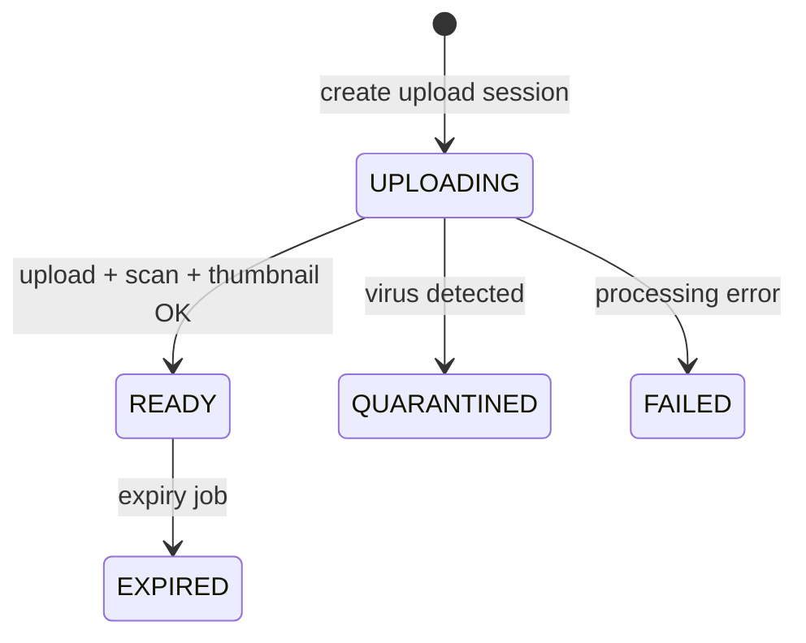
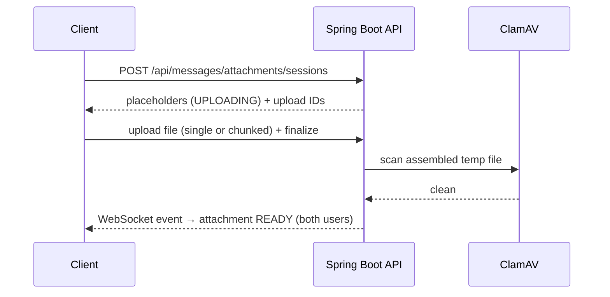
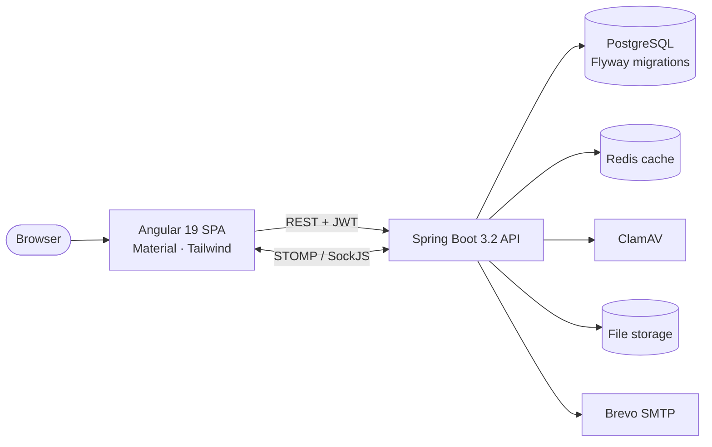

<div align="center">

# 🏡 Riad

### *Moments, gathered.*

A full-stack social network inspired by Instagram, wrapped in a warm Moroccan-courtyard design.
Share posts, follow people, chat in real time, and send secure attachments — all with live updates.


</div>

---

## ✨ Features

| | |
|---|---|
| 🔐 **Authentication** | Register / login with JWT, password reset by email (Brevo SMTP) with rate limiting |
| 📸 **Posts** | Create, edit and delete posts with images, like and explore feed |
| 💬 **Comments** | Threaded replies, emoji reactions on comments, `@mentions` |
| 👥 **Social graph** | Follow / unfollow, user search, public profiles |
| 🔔 **Notifications** | Realtime (WebSocket) for follows, likes, comments, replies and mentions, with unread counter |
| ✉️ **Direct messages** | Private conversations, typing indicators, read receipts, live delivery over STOMP |
| 📎 **Chat attachments** | Multi-file, chunked uploads, virus scanning, expiring media, signed downloads |
| 🛡️ **Security** | Spring Security + JWT, MIME sniffing, ClamAV scanning, signed attachment tokens |

## 📎 Chat attachments in depth

Production-style attachments for private messaging, with realtime status updates.

- **Types:** images (JPEG, PNG, WEBP, GIF), videos (MP4, WEBM, MOV), documents (PDF, TXT, DOC/DOCX, XLS/XLSX, PPT/PPTX)
- Up to **6 attachments per message** (configurable), with chunked uploads and per-file progress
- **Client-side image compression** (max 1080px, ~0.8 quality) with EXIF-safe orientation
- **Server-side MIME sniffing** (Apache Tika) and size enforcement
- **Virus scanning** through ClamAV, with an optional fail-closed mode
- **Expiring media** with scheduled cleanup
- **Signed download / streaming endpoints** with HTTP Range support
- Image **alt text** editing





## 🧱 Architecture



## 🛠️ Tech stack

**Frontend** — Angular 19, Angular Material & CDK, Tailwind CSS, RxJS, STOMP.js + SockJS, Karma/Jasmine
**Backend** — Java 17, Spring Boot 3.2 (Web, Security, Data JPA, WebSocket, Mail, Cache), JJWT, Apache Tika, Thumbnailator, JUnit / Mockito
**Infra** — PostgreSQL 13, Redis 7, ClamAV, Flyway, Docker Compose
**Quality** — GitHub Actions, JaCoCo, SonarCloud quality gate, pre-push git hooks

## 🚀 Getting started

### Option 1 — Docker Compose (recommended)

Starts PostgreSQL, Redis, ClamAV, the API and the frontend.

```bash
docker compose up --build
```

| Service | URL |
|---|---|
| Frontend | http://localhost:4200 |
| Backend API | http://localhost:8080 |

Optional environment variables (for password-reset emails): `BREVO_SMTP_USERNAME`, `BREVO_SMTP_PASSWORD`, `MAIL_FROM`, `FRONTEND_BASE_URL`, `BACKEND_BASE_URL`.

Offline or DNS issues? Build with locally available images:

```bash
docker-compose build --pull=false
docker-compose up -d
```

### Option 2 — Run services manually

Start the dependencies (`docker compose up postgres redis clamav -d`), then:

```bash
# Backend  (http://localhost:8080)
cd backend
./mvnw spring-boot:run
```

```bash
# Frontend (http://localhost:4200)
cd frontend
npm ci
npm start
```

> **Default admin account** is seeded on first start (`admin@admin.com` / `admin123456`). Override it with the `admin.user.*` properties and change it before any real deployment.

## 🔌 API overview

| Area | Endpoints |
|---|---|
| Auth | `POST /api/auth/register` · `login` · `forgot-password` · `reset-password` |
| Posts | `GET/POST /api/posts` · `GET /api/posts/explore` · `PUT/DELETE /api/posts/{id}` · `POST /api/posts/{id}/like` |
| Comments | `POST /api/posts/{id}/comment` · `DELETE …/comments/{commentId}` · `POST …/comments/{commentId}/reactions` |
| Users | `GET /api/users/{username}` · `GET /api/users/search` · `POST /api/users/{username}/follow` · `unfollow` · `PUT /api/users/me` |
| Messages | `GET /api/messages/conversations` · `POST /api/messages` · `PUT …/conversations/{id}/read` |
| Attachments | `POST /api/messages/attachments/sessions` · `POST …/uploads/{id}` · `…/uploads/{id}/finalize` · `GET …/{attachmentId}` |
| Notifications | `GET /api/notifications` · `GET …/unread-count` · `PUT …/read` |

Full attachment API reference: [`docs/api-chat-attachments.md`](docs/api-chat-attachments.md).

## ⚙️ Configuration

Defaults live in [`backend/src/main/resources/application.properties`](backend/src/main/resources/application.properties).

<details>
<summary><b>Attachment, scanning and storage settings</b></summary>

**Limits**
`message.attachments.max-files` · `max-image-bytes` · `max-video-bytes` · `max-document-bytes` · `max-pending-per-user` · `chunk-size-bytes` · `max-expiry-hours` · `expiry-cron` · `download-token-ttl-seconds`
`spring.servlet.multipart.max-file-size` · `spring.servlet.multipart.max-request-size`

**Virus scanning**
`virus.scan.enabled` · `host` · `port` · `timeout-seconds` · `fail-closed`

**Storage**
`storage.message-attachments-location` · `-temp-location` · `-quarantine-location` · `-thumbnail-location`

**URLs**
`backend.base-url` (links generated by async processing) · `frontend.base-url`

</details>

## 🗂️ Project structure

```
riad-social/
├── backend/            # Spring Boot API (auth, post, message, notification, profile, storage…)
│   └── src/main/resources/db/migration/   # Flyway migrations
├── frontend/           # Angular 19 SPA (home, explore, messages, profile, auth…)
├── docs/               # Attachment docs, testing guide, ADRs
├── scripts/            # Local CI scripts (PowerShell) and git-hook setup
├── .github/workflows/  # CI: tests, coverage, SonarCloud
├── docker-compose.yml
└── BRAND.md            # Design system
```

## 🎨 Design

The **Riad** identity is inspired by Moroccan materials — terracotta clay, brass details and jade tilework — with Marcellus and Sora typography.

| Terracotta | Brass | Jade | Cream | Sand | Ink |
|:-:|:-:|:-:|:-:|:-:|:-:|
| `#C65A3B` | `#D4A24C` | `#1F8A70` | `#F7F1E6` | `#EFE3D6` | `#1C1A17` |

See [`BRAND.md`](BRAND.md) for the full guide.

## ✅ Testing & quality

Extensive unit tests on both sides (JUnit/Mockito for services, controllers, security and WebSocket config; Jasmine/Karma for components and services). CI runs tests, builds, and a SonarCloud Quality Gate on every push.

```bash
# Run everything locally before pushing
./scripts/ci-all.ps1

# Or individually
cd backend  && ./mvnw verify
cd frontend && npm test -- --watch=false --browsers=ChromeHeadless
```

Enable the pre-push hook with `./scripts/setup-git-hooks.ps1`. More in [`CONTRIBUTING.md`](CONTRIBUTING.md).

## 📚 Docs

- [Chat attachments — backend](docs/chat-attachments.md)
- [Chat attachments — UI](docs/chat-attachments-ui.md)
- [Attachments API](docs/api-chat-attachments.md)
- [Testing attachments](docs/testing-chat-attachments.md)
- [ADR 0001 — Chat attachments](docs/adr/0001-chat-attachments.md)

## 🤝 Contributing

Contributions are welcome — see [`CONTRIBUTING.md`](CONTRIBUTING.md) for setup, hooks and conventions.

---

<div align="center">

Built with ☕ by [gripexdev](https://github.com/gripexdev) · *Share your courtyard.*

</div>
